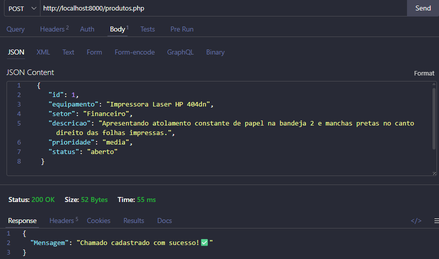
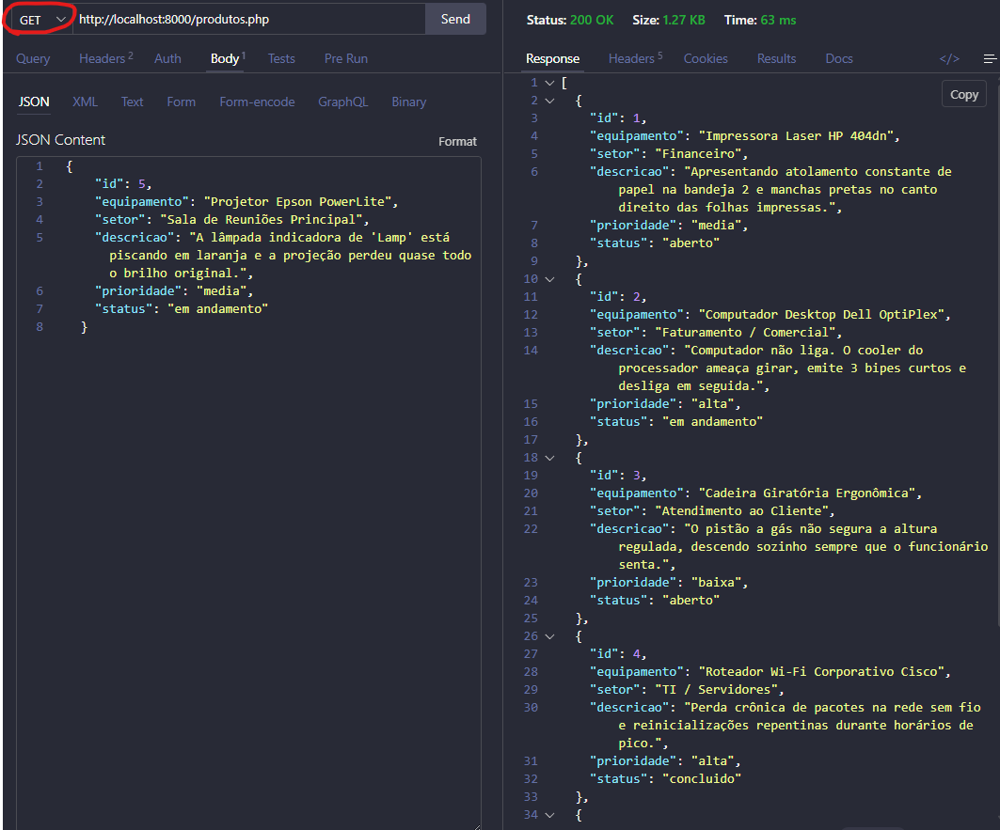
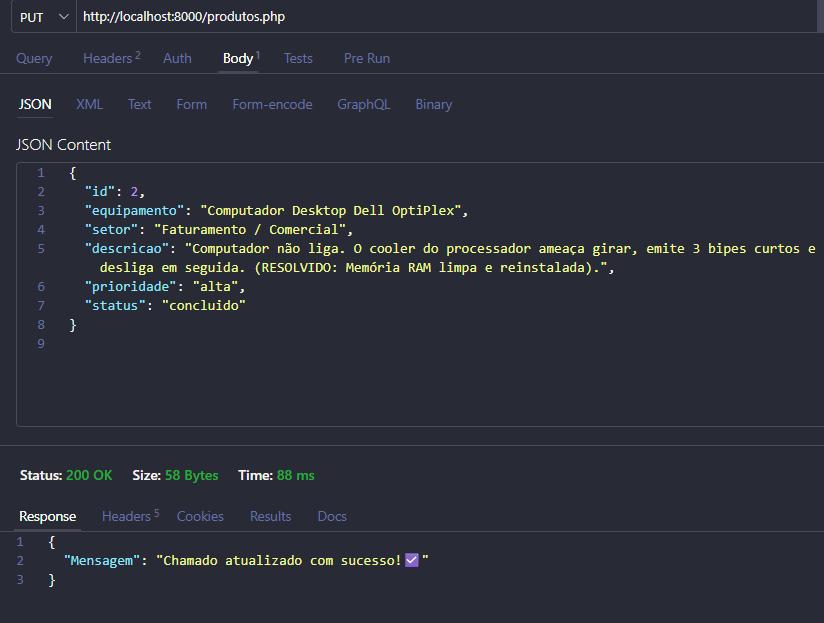
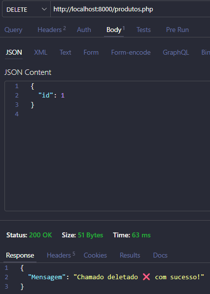
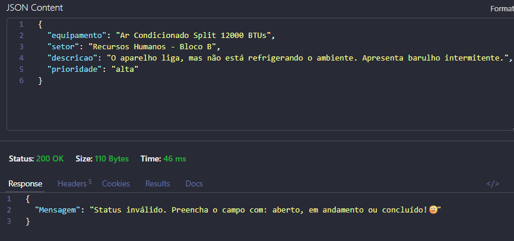
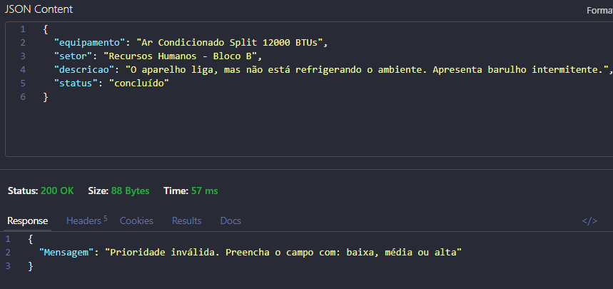

# 🔧 API para Controle de Chamados de Manutenção

## 📌 Sobre o projeto

Este projeto consiste no desenvolvimento de uma API em PHP para auxiliar no controle de chamados de manutenção de equipamentos de uma empresa.

A proposta surgiu a partir da necessidade de organizar os problemas informados pelos funcionários, facilitando o registro, a consulta, a atualização e a exclusão dos chamados de manutenção.

A API utiliza **PHP, PDO, PostgreSQL e JSON** e implementa as quatro operações básicas de um CRUD:

* **POST** — cadastrar um novo chamado;
* **GET** — listar os chamados cadastrados;
* **PUT** — atualizar um chamado;
* **DELETE** — excluir um chamado.

---

## 🎯 Objetivo

Desenvolver uma API capaz de realizar o gerenciamento de chamados de manutenção de equipamentos, permitindo que as informações sejam armazenadas e manipuladas de forma organizada por meio de requisições HTTP.

O sistema também realiza verificações dos dados informados, como os campos obrigatórios, a prioridade e o status do chamado.

---

## 🛠️ Tecnologias utilizadas

* **PHP** — desenvolvimento da API;
* **PostgreSQL** — banco de dados;
* **PDO** — conexão entre PHP e PostgreSQL;
* **JSON** — formato utilizado para envio e recebimento dos dados;
* **Thunder Client** — realização dos testes das requisições;
* **Git e GitHub** — controle e armazenamento do projeto.

---

## 📁 Estrutura do projeto

```text
api-manutencao/
│
├── conexao.php
├── produtos.php
└── README.md
```

### `conexao.php`

Responsável por realizar a conexão do PHP com o banco de dados PostgreSQL utilizando PDO.

### `produtos.php`

Arquivo principal da API. Nele estão implementadas as operações de cadastro, consulta, atualização e exclusão dos chamados.

### `README.md`

Arquivo utilizado para apresentar e documentar o projeto.

---

## 🗄️ Banco de dados

Foi criado um banco de dados chamado:

```text
manutencao
```

Dentro dele foi criada a tabela:

```text
chamados
```

A tabela possui os seguintes campos:

| Campo         | Descrição                                |
| ------------- | ---------------------------------------- |
| `id`          | Identificação do chamado                 |
| `equipamento` | Equipamento que apresentou o problema    |
| `setor`       | Setor onde o equipamento está localizado |
| `descricao`   | Descrição do problema                    |
| `prioridade`  | Prioridade do chamado                    |
| `status`      | Situação atual do chamado                |

O campo `id` é a chave primária e possui incremento automático.

Código utilizado para a Criação da tabela:
```sql
CREATE TABLE chamados (
    id SERIAL PRIMARY KEY,
    equipamento VARCHAR (100) NOT NULL,
    setor VARCHAR (60) NOT NULL,
    descricao TEXT NOT NULL,
    prioridade VARCHAR (50) NOT NULL,
    status VARCHAR (50) NOT NULL
);

```

---

## 📊 Regras do sistema

A API trabalha com três níveis de prioridade:

```text
baixa
media
alta
```

Os chamados também possuem três possibilidades de status:

```text
aberto
em andamento
concluido
```

Antes de realizar as operações, a API verifica se os campos obrigatórios foram informados e se os valores de prioridade e status estão de acordo com as opções estabelecidas para o projeto.

---

## 🔄 Operações CRUD

### ➕ POST — Cadastrar chamado

O método **POST** é utilizado para cadastrar um novo chamado.

Exemplo de dados enviados:

```json
{
    "id": 1,
    "equipamento": "Impressora Laser HP 404dn",
    "setor": "Financeiro",
    "descricao": "Apresentando atolamento constante de papel na bandeja 2 e manchas pretas no canto direito das folhas impressas.",
    "prioridade": "media",
    "status": "aberto"
  }
```

Após o cadastro, a API retorna uma mensagem em JSON informando o resultado da operação.

Exemplo:

```json
{
    "Mensagem": "Chamado cadastrado com sucesso!"
}
```

#### Exemplo 📸


---

### 🔎 GET — Listar chamados

O método **GET** é utilizado para consultar todos os chamados cadastrados no banco de dados.

A API retorna os registros em formato JSON.


#### Exemplo 📸



---

### ✏️ PUT — Atualizar chamado

O método **PUT** é utilizado para atualizar os dados de um chamado existente utilizando seu `id`.

Exemplo:

```json
{
  "id": 2,
  "equipamento": "Computador Desktop Dell OptiPlex",
  "setor": "Faturamento / Comercial",
  "descricao": "Computador não liga. O cooler do processador ameaça girar, emite 3 bipes curtos e desliga em seguida. (RESOLVIDO: Memória RAM limpa e reinstalada).",
  "prioridade": "alta",
  "status": "concluido"
}

```

Após a atualização, a API retorna uma mensagem informando o resultado da operação.

Exemplo:

```json
{
    "Mensagem": "Chamado atualizado com sucesso!"
}
```

#### Exemplo 📸



---

### 🗑️ DELETE — Excluir chamado

O método **DELETE** é utilizado para excluir um chamado pelo seu `id`.

Exemplo:

```json
{
    "id": 1
}
```

Após a exclusão, a API retorna uma mensagem em JSON.

Exemplo:

```json
{
    "Mensagem": "Chamado deletado com sucesso!"
}
```

#### Exemplo 📸



---

## 🧪 Testes da API

Os testes das operações foram realizados utilizando o **Thunder Client**, permitindo verificar o funcionamento de cada método do CRUD.

Foram realizados testes de:

* Cadastro de chamados;
* Consulta dos chamados;
* Atualização de chamados;
* Exclusão de chamados;
* Validação dos campos obrigatórios;
* Validação da prioridade;
* Validação do status.

---

## 🔐 Validação dos dados

A API realiza verificações antes de executar as operações.

Entre as validações realizadas estão:

* Verificação dos campos obrigatórios;
* Verificação da prioridade;
* Verificação do status;
* Verificação do `id` nas operações que necessitam dele.

Quando os dados não estão de acordo com o esperado, a API retorna uma mensagem em formato JSON informando o problema.

Exemplo:

```json
{
            "Mensagem":"Status inválido. Preencha-o com: aberto, em andamento ou concluído!🙂"
            {
            "Mensagem":"Prioridade inválida. Preencha-o com: baixa, média ou alta"
            }

}
```
#### Teste dos Status 📸 

 

#### Teste das Prioridades 📸

 


---

## ▶️ Como executar o projeto

### 1. Criar o banco de dados

No PostgreSQL, crie o banco:

```sql
CREATE DATABASE manutencao;
```

Depois, crie a tabela `chamados`.

### 2. Configurar a conexão

No arquivo `conexao.php`, informe os dados de acesso ao PostgreSQL.

### 3. Iniciar o servidor PHP

Abra o terminal na pasta do projeto e execute:

```bash
php -S localhost:8000
```

### 4. Realizar os testes

Abra o Thunder Client e utilize o endereço:

```text
http://localhost:8000/produtos.php
```

A partir desse endereço, podem ser realizadas as requisições **POST, GET, PUT e DELETE**.

---

## 📚 Conceitos utilizados

Durante o desenvolvimento do projeto foram utilizados conceitos estudados em aula, como:

* API;
* CRUD;
* PHP;
* PostgreSQL;
* PDO;
* JSON;
* Métodos HTTP;
* `if`;
* `$_SERVER`;
* `file_get_contents()`;
* `json_decode()`;
* `json_encode()`;
* `prepare()`;
* `execute()`;
* `query()`;
* `fetchAll()`.

---

## 👩‍💻 Projeto acadêmico

Projeto desenvolvido como atividade prática do curso de **Desenvolvimento de Sistemas – SENAI**, com o objetivo de aplicar os conhecimentos de desenvolvimento de APIs, banco de dados e operações CRUD.

---

## 📌 Considerações finais

O projeto permitiu colocar em prática a criação de uma API utilizando PHP e PDO, além da integração com um banco de dados PostgreSQL.

Com as operações de **POST, GET, PUT e DELETE**, é possível realizar o gerenciamento dos chamados de manutenção, desde seu cadastro até sua atualização e exclusão.

O desenvolvimento também possibilitou praticar o recebimento e envio de informações em formato JSON e a realização de validações dos dados recebidos pela API.
